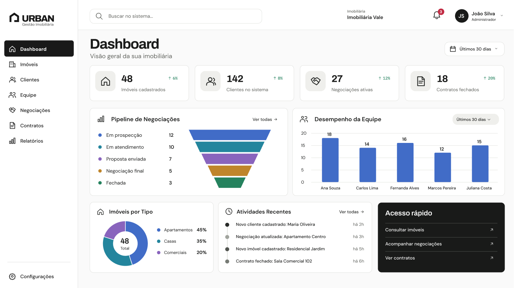

# URBAN — Gestão Imobiliária

Aplicação web para organizar a operação de uma imobiliária: carteira de imóveis, clientes, negociações, contratos, equipe e indicadores em um mesmo ambiente.

O URBAN foi desenvolvido como projeto de portfólio, com foco na relação entre fluxo operacional, experiência de uso e qualidade de software. O objetivo é representar uma rotina imobiliária de ponta a ponta, do cadastro de um imóvel à conclusão de uma venda ou locação.



> A imagem acima é uma composição de apresentação da interface, não uma captura de uma base de produção. Os números exibidos nela são ilustrativos. No sistema, os indicadores são calculados a partir dos registros da imobiliária.

## O que o sistema faz

- **Imóveis:** cadastro, edição, busca, publicação no catálogo interno e controle de disponibilidade.
- **Clientes:** registro de interessados, vínculo com imóveis e histórico de atendimentos.
- **Negociações:** acompanhamento das etapas comerciais, da prospecção ao fechamento.
- **Contratos e operações:** geração de registros contratuais a partir de negociações fechadas, acompanhamento de situação e conclusão de venda ou locação.
- **Equipe:** convites e perfis de administrador e corretor, com diferentes permissões.
- **Dashboard e relatórios:** indicadores calculados a partir da carteira, visualização de resultados e exportação CSV.
- **Interface:** layout responsivo e alternância entre temas claro e escuro.

A aplicação separa os dados de cada imobiliária. Corretores compartilham a carteira de imóveis da organização, mas visualizam apenas seus próprios clientes, negociações e contratos. Administradores podem acompanhar a operação completa.

## Tecnologias

| Camada | Tecnologias |
| --- | --- |
| Interface | Next.js 15, React 19, TypeScript, CSS e Recharts |
| Formulários | React Hook Form e Zod |
| Autenticação e persistência | Supabase Auth, PostgreSQL, Edge Functions |
| Testes | Node.js Test Runner, Playwright e casos manuais documentados para Qase |
| Hospedagem | Compatível com Vercel |

## Executar localmente

**Requisitos:** Node.js 22 ou 24 e um projeto Supabase configurado para o URBAN.

```bash
npm ci
cp .env.example .env.local
npm run dev
```

No Windows, copie o arquivo `.env.example` para `.env.local` manualmente. Caso o PowerShell bloqueie `npm.ps1`, utilize `npm.cmd ci` e `npm.cmd run dev`.

Preencha o `.env.local` com as informações do **seu** projeto Supabase:

```dotenv
NEXT_PUBLIC_SUPABASE_URL=https://SEU-PROJETO.supabase.co
NEXT_PUBLIC_SUPABASE_ANON_KEY=SUA_CHAVE_PUBLICA
```

Aplique o arquivo [`supabase/schema.sql`](supabase/schema.sql) no SQL Editor do projeto e publique a Edge Function:

```bash
supabase functions deploy urban-workspace --project-ref SEU_PROJECT_REF
```

Configure no Supabase Auth os redirecionamentos para `http://localhost:3000` e para a URL de produção. Habilite autenticação por e-mail/senha e confirmação de e-mail. Para o envio confiável de e-mails em produção, configure SMTP.

Acesse **http://localhost:3000**. A aplicação permite criar uma conta, cadastrar a imobiliária e iniciar uma carteira vazia. **Sem o Supabase configurado, a interface pública pode ser visualizada, mas o login e o painel não funcionam.**

## Percurso sugerido

1. Cadastre uma imobiliária e um imóvel.
2. Registre um cliente e associe-o a um imóvel de interesse.
3. Crie uma negociação, avance as etapas e feche o negócio.
4. Gere um contrato, registre a evolução das assinaturas e conclua a operação.
5. Confira o novo status do imóvel e os resultados no dashboard e nos relatórios.
6. Convide um segundo usuário para testar a experiência de corretor.

Use apenas dados fictícios em ambientes de demonstração.

## Decisões de implementação

As regras de negócio ficam em [`supabase/functions/_shared/domain.ts`](supabase/functions/_shared/domain.ts), utilizadas tanto na aplicação quanto na função que processa os comandos. A API do Next.js encaminha as solicitações autenticadas à Edge Function, que identifica o usuário pelo Supabase Auth, consulta seu vínculo com uma imobiliária e aplica as permissões.

A persistência utiliza um documento JSONB por imobiliária, com controle de versão para evitar que duas atualizações sobrescrevam silenciosamente o mesmo estado. O banco também verifica a unicidade dos códigos dos imóveis. Essa abordagem foi adotada para o escopo deste estudo de caso; não pretende substituir uma modelagem relacional mais granular para operações de maior escala.

**Limites do escopo:** publicação de imóvel significa alteração de estado **dentro do URBAN**, não publicação automática em portais externos. O envio de contratos para assinatura e o registro das assinaturas são **etapas operacionais controladas manualmente**, sem integração com uma plataforma de assinatura eletrônica. A preferência de resumo semanal é armazenada, mas não existe disparo automático de e-mail. A criação de convites gera um link para ser compartilhado; o sistema não envia esse convite automaticamente.

## Testes e qualidade

```bash
npm run typecheck
npm test
npm run build
npx playwright install chromium
npm run test:e2e
```

Os testes unitários verificam regras de negócio, consistência dos registros e permissões. Os testes Playwright cobrem a navegação pública e validações iniciais; o cenário autenticado de venda exige uma conta específica de QA e é ignorado quando as credenciais não estão configuradas. Consulte [`qa/README.md`](qa/README.md) para os pré-requisitos e os [casos de teste para importação no Qase](qa/qase-urban.csv).

Os scripts e cenários disponíveis **não equivalem, por si só, a uma execução aprovada**. Evidências, falhas encontradas e resultados devem ser registrados a cada rodada real de testes.

## Estrutura do repositório

```text
app/                 Páginas, estilos e rota de API
components/          Componentes e módulos da interface
lib/                 Formulários e integração com o serviço
public/              Elementos de identidade e imagens
qa/                  Casos manuais e instruções de QA
supabase/            Banco, funções e testes SQL
tests/               Testes unitários e de navegador
```

## Publicação

O projeto pode ser implantado na Vercel usando o preset **Next.js**. Configure as mesmas duas variáveis públicas da seção de instalação e registre o domínio de produção nos redirecionamentos do Supabase Auth.

Não versione `.env.local`, credenciais de contas de QA, resultados de testes com dados pessoais ou chaves privilegiadas. A Edge Function usa a credencial de serviço disponível **no ambiente do Supabase**, nunca no cliente.

Este repositório documenta um projeto de portfólio e não deve ser interpretado como um produto imobiliário homologado para uso comercial.
